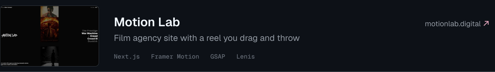
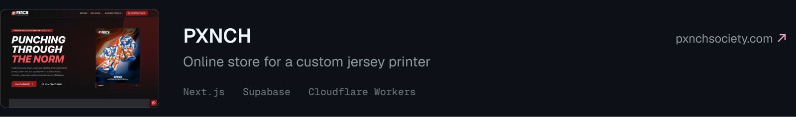
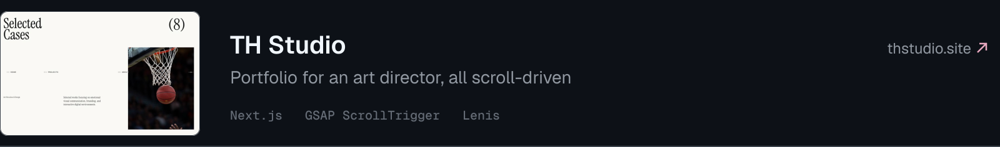
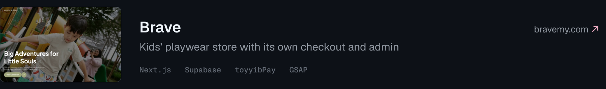
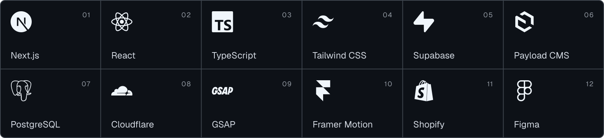
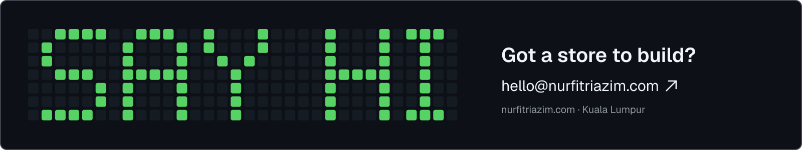
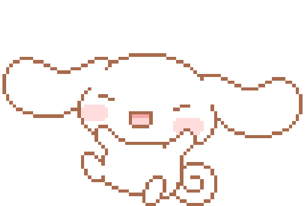

<picture>
  <source media="(prefers-color-scheme: dark)" srcset="./assets/hero-dark.svg">
  <source media="(prefers-color-scheme: light)" srcset="./assets/hero-light.svg">
  
</picture>

I’m Azim. I design and build websites and online stores for Malaysian businesses, from the first sketch to the checkout and the admin panel the owner uses every day. Software Development student at UTeM.

###### (SELECTED WORK)

<a href="https://motionlab.digital" title="Open motionlab.digital"><picture><source media="(prefers-color-scheme: dark)" srcset="./assets/work-motionlab-dark.svg"><source media="(prefers-color-scheme: light)" srcset="./assets/work-motionlab-light.svg"></picture></a>
<a href="https://pxnchsociety.com" title="Open pxnchsociety.com"><picture><source media="(prefers-color-scheme: dark)" srcset="./assets/work-pxnch-dark.svg"><source media="(prefers-color-scheme: light)" srcset="./assets/work-pxnch-light.svg"></picture></a>
<a href="https://thstudio.site" title="Open thstudio.site"><picture><source media="(prefers-color-scheme: dark)" srcset="./assets/work-thstudio-dark.svg"><source media="(prefers-color-scheme: light)" srcset="./assets/work-thstudio-light.svg"></picture></a>
<a href="https://bravemy.com" title="Open bravemy.com"><picture><source media="(prefers-color-scheme: dark)" srcset="./assets/work-brave-dark.svg"><source media="(prefers-color-scheme: light)" srcset="./assets/work-brave-light.svg"></picture></a>

###### (WHAT I DO)

<picture>
  <source media="(prefers-color-scheme: dark)" srcset="./assets/services-dark.svg">
  <source media="(prefers-color-scheme: light)" srcset="./assets/services-light.svg">
  
</picture>

###### (STACK)

<picture>
  <source media="(prefers-color-scheme: dark)" srcset="./assets/stack-dark.svg">
  <source media="(prefers-color-scheme: light)" srcset="./assets/stack-light.svg">
  
</picture>

<b>What I’m up to now</b>

 

Building **Sedapify v2**, an AI recipe app in Expo. Semester 5 of Software Development at UTeM. A few client stores alongside.

 

<a href="mailto:hello@nurfitriazim.com" title="Email hello@nurfitriazim.com"><picture><source media="(prefers-color-scheme: dark)" srcset="./assets/footer-dark.svg"><source media="(prefers-color-scheme: light)" srcset="./assets/footer-light.svg"></picture></a>

