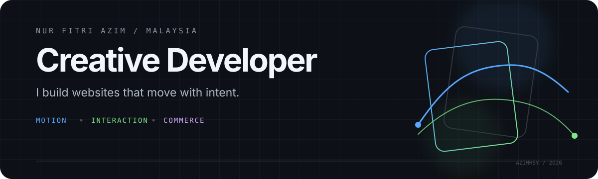

  

 

I’m **Azim**, a creative developer from Malaysia. I design and build expressive web experiences where motion supports the story, interaction feels deliberate, and the engineering holds up behind the surface.

Currently building websites and commerce experiences for Malaysian businesses while studying software development at UTeM.

[Portfolio](https://nurfitriazim.com) · [Email](mailto:hello@nurfitriazim.com)

## Selected work

| Project | What it explores |
| --- | --- |
| **[Scroll to Play](https://github.com/AzimHsy/Scroll-to-Play)** | A scroll-controlled image-sequence experience built with Next.js, GSAP and Lenis. |
| **[Cursor Animation](https://github.com/AzimHsy/Cursor-Animation)** | A responsive cursor-mask interaction using Framer Motion and Sass. |
| **[Wellness Link](https://github.com/AzimHsy/Wellness-Link-Website)** | An animated health-awareness experience with interactive lifestyle and depression quizzes. |
| **[nest-commerce](https://github.com/AzimHsy/nest-commerce)** | A tested commerce backend focused on stock integrity, payment idempotency and reliable transactions. |

## Working with

`Next.js` · `TypeScript` · `GSAP` · `Framer Motion` · `React` · `NestJS` · `PostgreSQL` · `Supabase` · `Cloudflare`

Good motion has a reason. Good interfaces make that reason feel obvious.
