<picture>
  <source media="(prefers-color-scheme: dark)" srcset="./assets/banner-dark.svg">
  <source media="(prefers-color-scheme: light)" srcset="./assets/banner-light.svg">
  
</picture>

###### (INTRODUCTION)

### I craft premium digital experiences where bold design meets clean code — turning ideas into websites that truly perform.

I’m Azim, a full-stack developer and UI/UX designer from Kuala Lumpur. I design and build online stores and websites for Malaysian businesses, from the first sketch to the checkout, the courier booking and the admin panel the owner uses every day. I’m also studying Software Development at UTeM.

 

###### (WHAT I DO)

**Custom online stores** — Next.js with Supabase or Payload CMS, prices checked on the server, Malaysian payment gateways (CHIP, toyyibPay, HitPay) and Ninja Van shipping.

**Shopify, EasyStore & WooCommerce** — theme work, custom sections, catalogue imports and full store revamps.

**Brand sites with motion** — scroll-driven storytelling with GSAP and Framer Motion, designed in Figma first.

10+ client projects since I started freelancing in 2026, across fashion, beauty, automotive and sportswear. Client repos are private, but I’m happy to walk you through the work on a call.

 

###### (STACK)

<picture>
  <source media="(prefers-color-scheme: dark)" srcset="./assets/stack-dark.svg">
  <source media="(prefers-color-scheme: light)" srcset="./assets/stack-light.svg">
  
</picture>

 

###### (SELECTED WORK)

**01 — [Revelio](https://github.com/AzimHsy/Revelio)** 
A Chrome extension that reads the animation on any web page and writes the GSAP code to rebuild it, using the Claude API. 
React · Vite · Chrome MV3 · Claude API

**02 — [Scroll to Play](https://github.com/AzimHsy/Scroll-to-Play)** 
A 96-frame image sequence on canvas, scrubbed by scroll, so the page plays like a film. 
Next.js · GSAP ScrollTrigger · Lenis · Framer Motion

**03 — [nest-commerce](https://github.com/AzimHsy/nest-commerce)** 
The risky core of an online store, tested end to end: atomic stock, idempotent payment webhooks, price snapshots and vouchers. 
NestJS · Prisma · PostgreSQL · Next.js

**04 — [Cursor Animation](https://github.com/AzimHsy/Cursor-Animation)** 
A cursor mask that reveals a second layer of the page as you move. 
Next.js · Framer Motion · Sass

<picture>
  <source media="(prefers-color-scheme: dark)" srcset="./assets/footer-dark.svg">
  <source media="(prefers-color-scheme: light)" srcset="./assets/footer-light.svg">
  
</picture>

<a href="https://nurfitriazim.com">nurfitriazim.com</a> · <a href="mailto:hello@nurfitriazim.com">hello@nurfitriazim.com</a>

